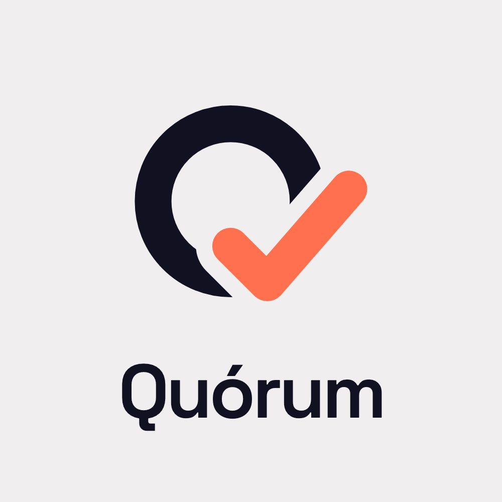

# Quórum — team-3 · Platanus Hack 26: Caracas ft. Yummy



**Trust the proof, not the organizer.**

Track: 🛡️ Trust

team-3

- Jose Gregorio Galvis Rivas ([@josegalvis27](https://github.com/josegalvis27))
- Jesus Galvis ([@jgalvis414](https://github.com/jgalvis414))
- César Augusto Gorge Gonzalez ([@cesargorge](https://github.com/cesargorge))

**Demo en vivo:** https://quorum-sefw.onrender.com · **Descripción:** [`project-description.md`](./project-description.md)

## Qué es

Votaciones internas (condominios, universidades, cooperativas, comunidades) con elegibilidad verificada, resultados en vivo y un **verificador independiente** que demuestra que el escrutinio publicado corresponde a las boletas incluidas. Cada boleta lleva una prueba Semaphore v4 de pertenencia al padrón (sin revelar quién), el registro va encadenado con hashes y el cierre se ancla en Base Sepolia. Lo que no garantizamos está escrito en [`docs/KNOWN_LIMITATIONS.md`](./docs/KNOWN_LIMITATIONS.md).

## Flujo de la demo

crear votación → proyectar QR → entrar con alias y prueba de vida → votar (2 toques) → resultados en vivo → cerrar y anclar → verificar el paquete → alterar una copia y ver el fallo detectado.

## Correr en local

Requiere Node 22 y pnpm 10.

```bash
pnpm install
cp apps/web/.env.example apps/web/.env.local   # sin claves funciona en modo demo (invitaciones dry-run, sin ancla)
pnpm dev                                        # http://localhost:3000
pnpm verify                                     # typecheck + lint + tests + build
```

## Verificar un paquete de auditoría sin confiar en el servidor

```bash
pnpm --filter @quorum/verifier verify packages/demo-fixtures/protocol/valid.json --pretty
pnpm --filter @quorum/verifier verify packages/demo-fixtures/protocol/tampered_total.json --pretty   # fallo detectado
```

El verificador (`apps/verifier`) no importa la app ni lee la base de datos: recomputa raíz del padrón, pruebas, nullifiers, cadena, recuento y ancla, y falla con causa concreta.

## Estructura

| Ruta | Qué hay |
|---|---|
| `apps/web` | Next.js: landing, organizador, sala por QR, boleta, resultados en vivo, transparencia, laboratorio de auditoría |
| `apps/verifier` | Verificador independiente (CLI y librería) |
| `packages/protocol-adapter` | Adaptador Semaphore v4 + ledger encadenado + paquete de auditoría |
| `packages/contracts` | Tipos y esquemas Zod del contrato de API |
| `packages/demo-fixtures` | Paquetes legítimos y adulterados (etiquetados como fixture) |
| `packages/wallet`, `packages/notify`, `packages/ui` | Smart wallet embebida, invitaciones, componentes |
| `contracts/QuorumRegistry.sol` | Contrato del ancla en Base Sepolia |
| `docs/` | Spec, ADR del motor, modelo de amenazas, limitaciones, resultados de pruebas, guion de demo |

Spec maestra: [`QUORUM_HACKATHON_TRUST_ECC_MASTER.md`](./QUORUM_HACKATHON_TRUST_ECC_MASTER.md).

## Repositorios y despliegue

El código se desarrolla en `josegalvis27/quorum-hackathon` (desde donde despliega Render) y se refleja en este repositorio de la organización con cada `git push`. El despliegue sigue corriendo desde el repositorio personal.

Este README y la documentación del proyecto se redactaron con ayuda de Claude Code y fueron revisados por el equipo.
